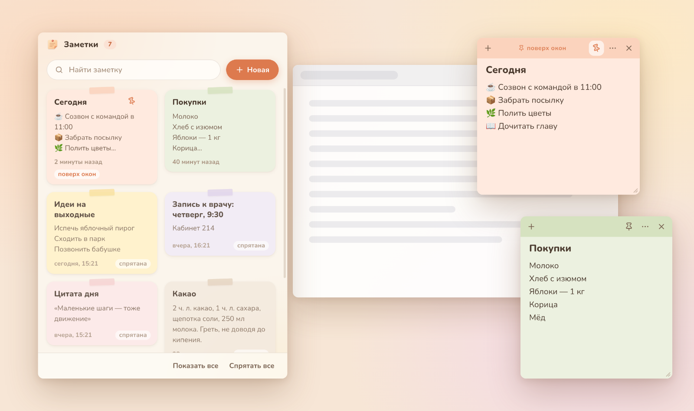
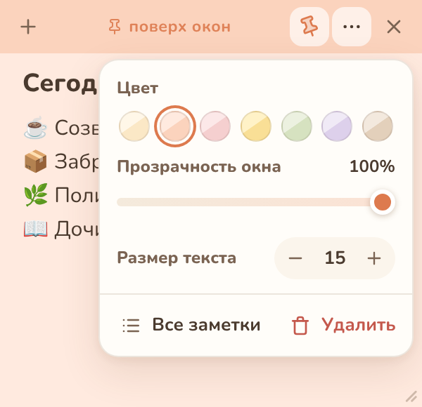

# Заметки

Тёплые заметки для Windows. Каждая заметка живёт в своём окошке: его можно
закрепить поверх всех окон, двигать и растягивать как удобно.



## Что умеет

- **Закрепление поверх окон.** Кнопка с булавкой (или `Ctrl+P`) держит заметку
  над всеми остальными окнами — удобно для списка дел, пароля от Wi‑Fi или
  текста, который нужно перепечатать.
- **Перемещение.** Тяните заметку за цветную полоску сверху.
- **Изменение размера.** Тяните за любой край окна или за уголок справа внизу.
- **Семь тёплых цветов:** сливочный, персиковый, розовый, медовый, шалфей,
  лавандовый и латте.
- **Прозрачность окна** от 40 до 100 % — закреплённая заметка не будет
  загораживать то, что под ней.
- **Размер текста** под себя: кнопки в меню, `Ctrl` + колесо мыши или
  `Ctrl+=` / `Ctrl+−`.
- **Всё сохраняется само**, вместе с положением и размером каждого окна.
  После перезапуска заметки появятся там же, где были.
- **Список всех заметок** с поиском, значок в трее и автозапуск вместе с Windows.



## Установка

Готовые файлы собирает GitHub Actions: вкладка **Actions** → последняя сборка
**«Сборка для Windows»** → архив **Zametki-Windows** внизу страницы.
Для тегов `v*` файлы попадают в **Releases**.

- `Zametki-Setup-1.0.0.exe` — обычный установщик (без прав администратора,
  создаёт ярлык «Заметки» на рабочем столе и в меню «Пуск»).
- `Zametki-Portable-1.0.0.exe` — версия без установки, просто запустить.

Приложение не подписано сертификатом, поэтому при первом запуске Windows
SmartScreen может показать предупреждение: «Подробнее» → «Выполнить в любом случае».

## Горячие клавиши

| Где | Клавиши | Что делают |
| --- | --- | --- |
| Заметка | `Ctrl+N` | новая заметка |
| Заметка | `Ctrl+P` | закрепить / открепить поверх окон |
| Заметка | `Ctrl+W` | спрятать заметку (она останется в списке) |
| Заметка | `Ctrl+=`, `Ctrl+−`, `Ctrl+0` | крупнее, мельче, обычный размер текста |
| Заметка | `Ctrl` + колесо мыши | размер текста |
| Список | `Ctrl+N` | новая заметка |
| Список | `Ctrl+F` | поиск |
| Список | `Delete` на карточке | удалить заметку |

## Где хранятся заметки

В файле `%APPDATA%\Zametki\notes.json`. Рядом лежит `notes.backup.json` —
предыдущая версия на случай сбоя. Если основной файл повредится, приложение
само восстановит заметки из резервной копии.

## Разработка

Нужен Node.js 22.

```bash
npm install
npm start          # запустить приложение
npm run check      # проверка синтаксиса и тесты хранилища
npm run dist       # собрать установщик и portable-версию в папку dist/
```

Сборку `npm run dist` лучше запускать на Windows. На Linux и macOS для
установщика NSIS понадобится Wine.

Устройство проекта:

```
src/
  main/main.js      главный процесс: окна, трей, IPC
  main/store.js     хранение заметок в JSON
  preload.js        безопасный мост между окнами и главным процессом
  renderer/         интерфейс: list.* — список, note.* — окно заметки
  assets/           иконка и шрифт Nunito
build/              исходники иконки для установщика
scripts/            перерисовка иконок (node scripts/build-icons.js, нужен Playwright)
test/               тесты хранилища (node --test)
```

Шрифт Nunito распространяется по лицензии SIL Open Font License 1.1
(`src/assets/fonts/OFL.txt`). Иконки в интерфейсе нарисованы в стиле Lucide (ISC), подробности в `THIRD_PARTY_NOTICES.md`.
